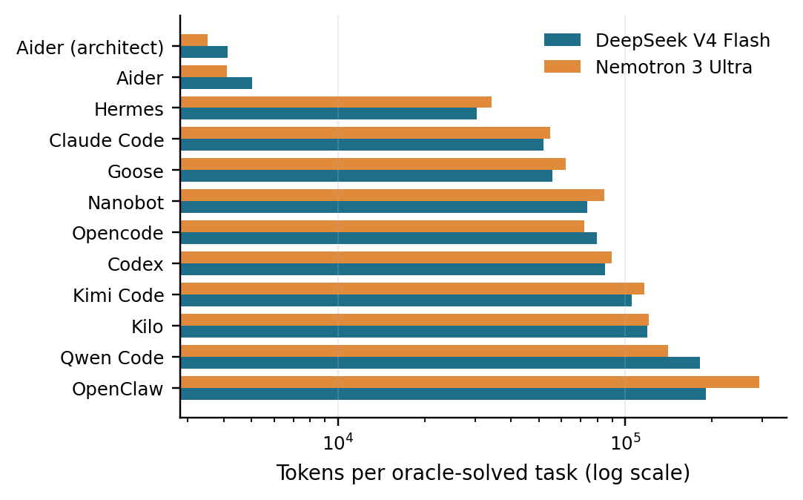

# Harness Efficiency Bench

Benchmark coding-agent harnesses on startup tax, context growth, token-denominated solve efficiency, solve rate, and optional dollar-cost metadata.

## Results

Twelve harness configurations ran the same 12 small Python tasks on the same model, once on DeepSeek V4 Flash and once on NVIDIA Nemotron 3 Ultra. Almost every harness solved almost every task, but the tokens spent per solved task differ by up to 70x.

Tokens per solved task, with the range across the two models:

| Harness | Tokens per solved task | Startup overhead |
|---|---:|---:|
| Aider (architect mode) | ~3,500-4,100 | ~700 |
| Aider | ~4,100-5,000 | ~3,000 |
| Hermes | ~30,000-34,000 | ~2,500 |
| Claude Code | ~52,000-55,000 | ~4,500 |
| Goose | ~56,000-62,000 | ~4,000 |
| Opencode | ~72,000-80,000 | ~8,500 |
| Nanobot | ~74,000-84,000 | ~9,000 |
| Codex | ~85,000-90,000 | ~8,200 |
| Kimi Code | ~105,000-116,000 | ~16,000 |
| Kilo | ~119,000-120,000 | ~14,700 |
| Qwen Code | ~141,000-182,000 | ~20,000 |
| OpenClaw | ~191,000-292,000 | ~26,000 |



- The ranking is nearly the same on both models. Startup overhead ranks identically, and cost per solved task differs by one adjacent swap.
- Startup overhead is resent on every turn, so it makes up most of the cost of the expensive harnesses.
- With 100k tokens of extra context injected, seven of the twelve configurations transmitted it in full and kept solving. Kilo and Opencode silently dropped 83-89% of it.

These numbers come from one run per harness and model on small tasks. Read more:

- [Write-up](https://eishanlawrence.com/blog/harness-efficiency-bench)
- [Full findings, including limits](docs/findings-non-swe-score-12.md)
- [Paper (PDF)](paper/paper.pdf)
- [Saved result snapshots](examples/results/README.md)

The v1 scaffold is designed around small task manifests and pluggable harness adapters. It can run a toy benchmark immediately, and it includes adapter entry points for Codex, Claude Code, Antigravity, Qwen Code, mini-swe-agent, nanobot, generic command-line harnesses, and Docker-only agent CLIs.

## Quick Start

Run the deterministic demo harness:

```bash
PYTHONPATH=src python3 -m harness_efficiency_bench.cli run-task \
  --task examples/tasks/toy-write-file/task.yaml \
  --harness examples/harnesses/demo.yaml
```

Run only Docker-isolated harnesses:

```bash
PYTHONPATH=src python3 -m harness_efficiency_bench.cli run-task \
  --task examples/tasks/toy-write-file/task.yaml \
  --harness examples/harnesses/generic-cli-docker.yaml \
  --require-docker-isolation \
  --delete-workspace
```

Build the example Codex Docker image:

```bash
docker build -t harness-bench/codex-cli:0.137.0 docker/codex-cli
```

Run a low-cost Codex Docker smoke task:

```bash
PYTHONPATH=src python3 -m harness_efficiency_bench.cli run-task \
  --task examples/tasks/toy-write-file/task.yaml \
  --harness examples/harnesses/codex-docker-cheap.yaml \
  --require-docker-isolation \
  --delete-workspace
```

Build the Claude Code Docker image and run the Docker-isolated API-key harness:

```bash
docker build -t harness-bench/claude-code:2.1.114 docker/claude-code
ANTHROPIC_API_KEY=... PYTHONPATH=src python3 -m harness_efficiency_bench.cli run-task \
  --task examples/tasks/toy-write-file/task.yaml \
  --harness examples/harnesses/claude-code-docker-isolated.yaml \
  --require-docker-isolation \
  --delete-workspace
```

Build and run a Docker-only agent CLI harness:

```bash
docker build -t harness-bench/goose:1.37.0 docker/goose
OPENAI_API_KEY=... PYTHONPATH=src python3 -m harness_efficiency_bench.cli run-task \
  --task examples/tasks/toy-write-file/task.yaml \
  --harness examples/harnesses/goose-docker-isolated.yaml \
  --require-docker-isolation \
  --delete-workspace
```

Preview Docker cleanup:

```bash
PYTHONPATH=src python3 -m harness_efficiency_bench.cli cleanup-docker
```

Remove benchmark-owned Docker images and optional build cache:

```bash
PYTHONPATH=src python3 -m harness_efficiency_bench.cli cleanup-docker --force --include-build-cache
```

Remove official SWE-bench evaluation images too:

```bash
PYTHONPATH=src python3 -m harness_efficiency_bench.cli cleanup-docker --force --include-swebench
```

Run the same task across all configured context-bloat perturbations:

```bash
PYTHONPATH=src python3 -m harness_efficiency_bench.cli run-task \
  --task examples/tasks/toy-write-file/task.yaml \
  --harness examples/harnesses/demo.yaml \
  --all-perturbations
```

Aggregate results:

```bash
PYTHONPATH=src python3 -m harness_efficiency_bench.cli report
```

Run tests:

```bash
PYTHONPATH=src python3 -m unittest discover -s tests
```

## Design

- **Tasks** define prompts, fixtures, oracle grading, budgets, and optional context perturbations.
- **Harnesses** define an adapter and execution settings.
- **Adapters** normalize each agent into a common run interface.
- **Traces** use JSONL events so metrics can be recomputed from raw data.
- **Metrics** are marked as full, partial, or unsupported based on trace visibility.
- **Isolation** is explicit in each result. Host runs are for debugging; serious runs should use Docker-backed harnesses with `--require-docker-isolation`.

Full A/B/C observability requires structured per-call usage from the harness, or routing OpenAI-compatible calls through the local usage-only proxy. Black-box CLI runs can still be scored for success and runtime, but startup tax, context growth, and solve efficiency are unsupported when neither native usage nor proxy routing is available.

The local non-SWE score suite is tagged `score-facing` and currently contains 12 tasks:

- `toy-write-file`: deterministic smoke/context-rot task.
- `python-fix-calculator`, `python-json-config-migration`, `python-csv-ledger-reconcile`, `python-markdown-link-normalizer`, `python-path-safety`, `python-datetime-windowing`, `python-cache-ttl-lru`, `python-cli-subcommands`, and `python-plugin-registry`: small Python tasks covering bug fixing, data processing, CLI behavior, security checks, stateful logic, and multi-file discovery.
- `harness-stress-log-triage` and `harness-stress-conflicting-specs`: context-heavy tasks that require selecting the relevant evidence from logs or competing specs.

`metrics-calibration-multicall` is separate: use it to check whether a harness emits enough per-call usage data for context-growth measurement, not as a solve-rate task.

Run only the local score-facing tasks with:

```bash
PYTHONPATH=src python3 -m harness_efficiency_bench.cli run-suite \
  --tasks-dir examples/tasks \
  --include-tag score-facing \
  --harness examples/harnesses/codex-docker-openrouter.yaml \
  --require-docker-isolation \
  --delete-workspace
```

`swe-bench-lite-curated-10` is a Docker-evaluated SWE-bench Lite subset. Build `docker/swebench-oracle`, then run tasks from `examples/tasks/swe-bench-lite-curated-10` with Docker-isolated harnesses.

Regenerate the SWE-bench Lite subset manifests:

```bash
PYTHONPATH=src python3 -m harness_efficiency_bench.cli import-swe-bench-lite
```

Build the Dockerized SWE-bench oracle without installing SWE-bench on the host:

```bash
docker build -t harness-bench/swebench-oracle:4.1.0 docker/swebench-oracle
```

Claude Code harnesses are split by auth and isolation:

- `claude-code`: host/local subscription debug harness. Requires `claude auth status` to show working account access.
- `claude-code-api`: host/API-key debug harness. Requires `ANTHROPIC_API_KEY`.
- `claude-code-docker-isolated`: Docker-isolated API-key harness for serious runs. Requires `ANTHROPIC_API_KEY` and the image build above.
- `claude-code-openrouter`: host/OpenRouter debug harness. Requires `OPENROUTER_API_KEY` and `OPENROUTER_MODEL`.
- `claude-code-docker-openrouter`: Docker-isolated OpenRouter harness. Requires `OPENROUTER_API_KEY`, `OPENROUTER_MODEL`, and the Claude Code image build above.

Set `CLAUDE_MAX_BUDGET_USD` to override Claude Code's CLI budget guard for Docker runs. The OpenRouter Docker manifest defaults to `1.00`; SWE-scale diagnostics may need a higher value even when OpenRouter reports zero provider cost for a free model.

Antigravity CLI is split into host debug and Docker-isolated OAuth modes:

- `antigravity-cli`: host/local CLI debug harness.
- `antigravity-sdk`: host/local SDK debug harness.
- `antigravity-cli-docker-isolated`: Docker-isolated CLI harness. Requires the `docker/antigravity` image and a dedicated `ANTIGRAVITY_AUTH_DIR` mounted into the container's Antigravity config directory.

Use a persistent `ANTIGRAVITY_AUTH_DIR`, such as `~/.harness-bench/antigravity-auth`, to avoid repeating Google OAuth between runs. OAuth is needed again only if that directory is deleted, the token is revoked/expired, or you switch to a different auth directory.

Docker-only agent CLI harnesses are API-key only and do not mount host OAuth or subscription state. Direct-provider examples are available for `goose`, `qwen-code`, `kimi-code`, `aider`, `opencode`, `kilo`, `nanobot`, `openclaw`, `hermes-agent`, and `grok-build`. Manifests marked `bench_ready: false` are scaffolds that still need live provider-key smoke verification before serious comparisons.

OpenRouter variants are available as `*-docker-openrouter.yaml` manifests for Docker CLIs except Grok Build, which uses xAI directly. Claude Code uses OpenRouter's Anthropic-compatible gateway at `https://openrouter.ai/api`; Codex and the other Docker CLIs use OpenRouter's OpenAI-compatible `/api/v1` route when a base URL is configurable. Set `OPENROUTER_API_KEY` and `OPENROUTER_MODEL`, for example:

```bash
export OPENROUTER_API_KEY=...
export OPENROUTER_MODEL="nvidia/nemotron-3-ultra-550b-a55b:free"
PYTHONPATH=src python3 -m harness_efficiency_bench.cli run-task \
  --task examples/tasks/toy-write-file/task.yaml \
  --harness examples/harnesses/codex-docker-openrouter.yaml \
  --require-docker-isolation \
  --delete-workspace
```

Grok Build uses xAI directly. Set `XAI_API_KEY` for `examples/harnesses/grok-build-docker-isolated.yaml`; the wrapper also accepts `GROK_CODE_XAI_API_KEY` for compatibility.

Antigravity CLI and Grok Build can be run as success-oracle harnesses, but they are excluded from A/B/C comparisons until their CLIs expose correct token telemetry through native usage events or routeable provider traffic.

## Adding Harnesses

Start with `examples/harnesses/generic-cli.yaml` if the harness can run one command and exit. Use a first-class adapter when the harness emits structured events or has an SDK. See `docs/adding-harnesses.md`.
